# Aether Grid

[](https://github.com/bileldh-ing/Aether-/actions/workflows/ci.yml)

A premium, dark smart-energy companion app for the **Aether Smart Home Power Core** — a 1,024 Wh home battery with three solar microinverters. Built with Flutter (Dart 3, null-safe) for Android and iOS.

The whole experience — onboarding → Bluetooth pairing → secure commissioning → live dashboard → grid outage and restore — runs **fully offline** against a realistic, deterministic device simulator, so it can be demoed and reviewed without hardware.

<p align="center">
  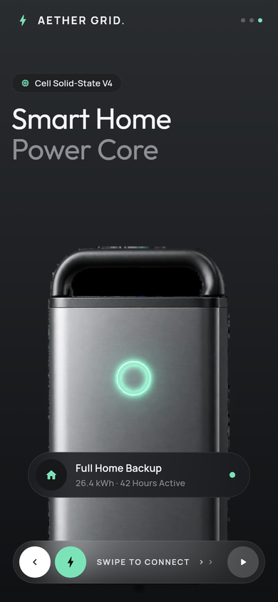
  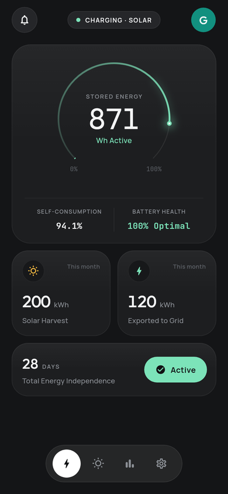
  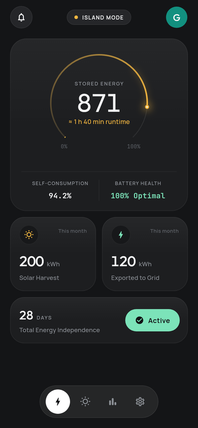
  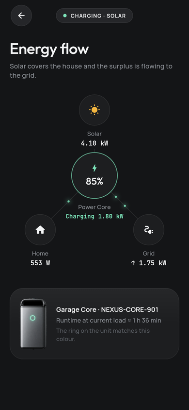
</p>

## Try it

- **Android:** download `app-release.apk` from the [demo-latest release](https://github.com/bileldh-ing/Aether-/releases/tag/demo-latest) (rebuilt on every push to `main`).
- **From source:** see [Run it](#run-it).

## Highlights

- **Live dashboard** — stored energy gauge, animated numbers, product hero with an LED ring that mirrors the real device state (breathe, fill, pulse, sweep).
- **Energy flow** — animated solar → battery → home → grid diagram with live wattages.
- **Solar** — today's production curve and per-microinverter status (Roof A / B / C).
- **Insights** — self-consumption, self-sufficiency, CO₂ avoided, money saved, and an independence streak.
- **Outage handling** — island mode, runtime estimate, toast + local notification, automatic restore.
- **Secure pairing** — radar scan, swipe-to-connect, QR fallback, Ed25519 owner key kept in secure storage.
- **Settings** — energy modes (self-consumption, backup priority, grid export, time-of-use), reserve, Storm Guard, firmware updates, members & roles.

## Run it

```bash
flutter pub get
flutter run            # Android or iOS device / emulator
flutter test           # unit + layout smoke tests
flutter test test_screens --update-goldens   # re-render docs screenshots
flutter analyze
```

Requirements: Flutter stable 3.3x+ (tested on 3.47), Dart 3.

## Demo controls

Long-press the **avatar** on the dashboard to open the scenario sheet:

| Action | Effect |
|--------|--------|
| Trigger outage | Grid drops, node islands, alert + notification with runtime estimate |
| Restore grid | Grid returns, confirmation alert |
| Low reserve | Battery forced under the reserve threshold |
| Firmware available | Offers `v4.9.0-Aether` with a staged install |
| Node offline | App keeps last-known data and shows the offline state |
| Fast-forward 6 h | Runs the physics forward to see the day change |
| Gallery | Every design-system component in one place |
| Reset demo | Back to first launch |

## Architecture

```
lib/
  app/            theme, router (go_router), providers (Riverpod), config, brand
  core/
    design_system/  tokens, typography, gauge, LED ring, radar, flow diagram, nav pill, sheets…
    services/       secure owner key (Ed25519), local notifications
    haptics/ utils/
  domain/         entities, pure metrics, PowerNodeRepository + ScenarioControl interfaces
  data/sources/
    mock/         deterministic simulator (day curves, battery physics, scenarios)
    ble/          BLE provisioning source (flutter_blue_plus) — stub
    live/         WebSocket telemetry source — stub
  features/       onboarding, pairing, shell, dashboard, energy_flow, solar, insights, alerts, settings, gallery
```

Dependencies flow inward: `features → domain ← data`. UI only ever talks to `PowerNodeRepository`.

## Swapping in real hardware

1. Implement `PowerNodeRepository` by composing `BleProvisioningSource` (scan, pair, commission) and `LiveLinkSource` (telemetry, commands over WebSocket or MQTT).
2. Set `AppConfig(useMockDevice: false, liveLinkUri: …)` and bind the new class in `powerNodeRepositoryProvider`.
3. Nothing in `features/` changes. Scenario hooks disappear automatically because only the simulator implements `ScenarioControl`.

## Screens

| Onboarding | | | Permissions |
|---|---|---|---|
| 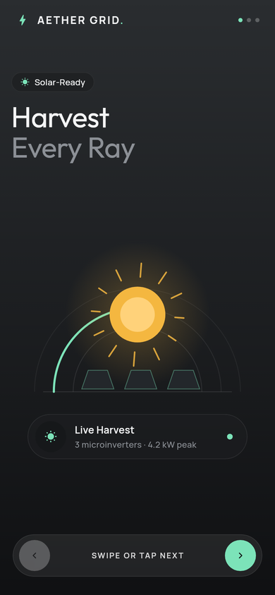 | 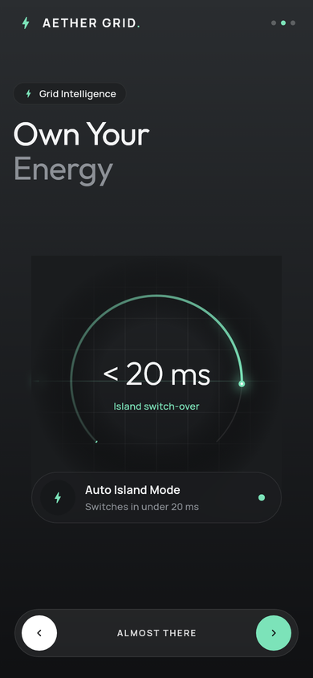 |  | 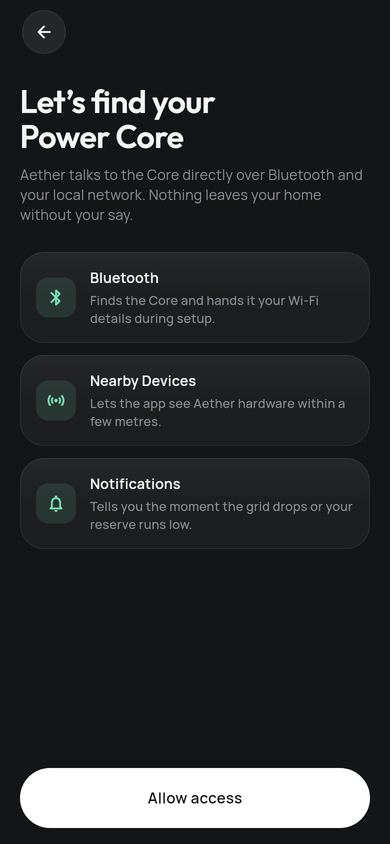 |
| **Dashboard** | **Outage (island mode)** | **Solar** | **Insights** |
|  |  | 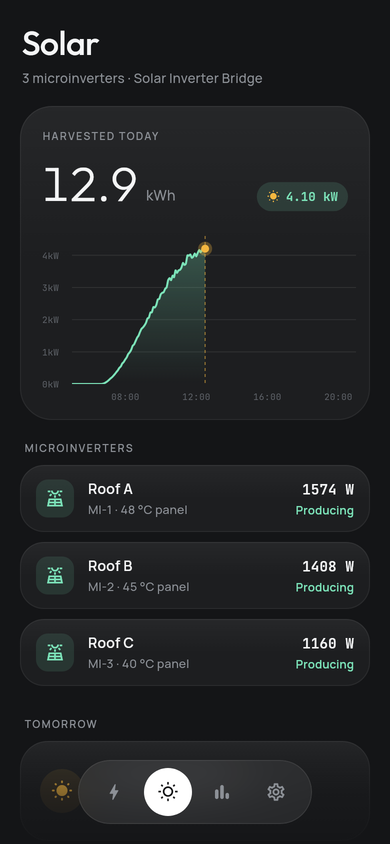 | 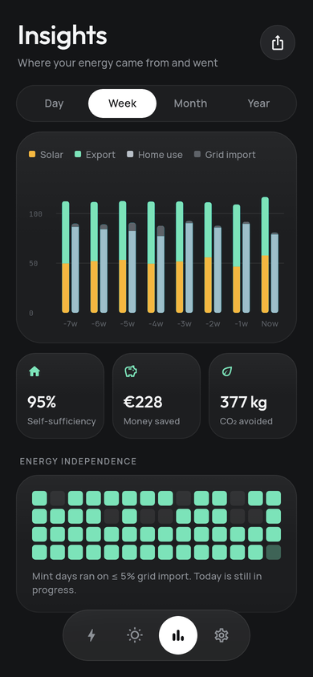 |
| **Settings** | **Energy flow** | **Independence streak** | **Component gallery** |
| 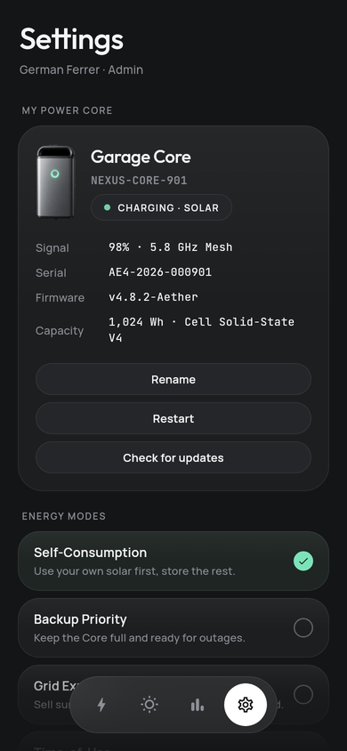 |  | 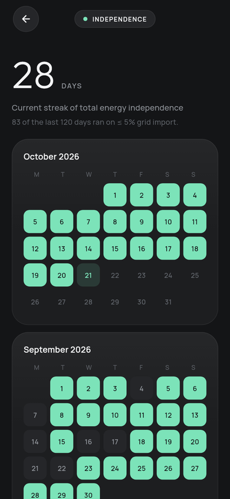 | 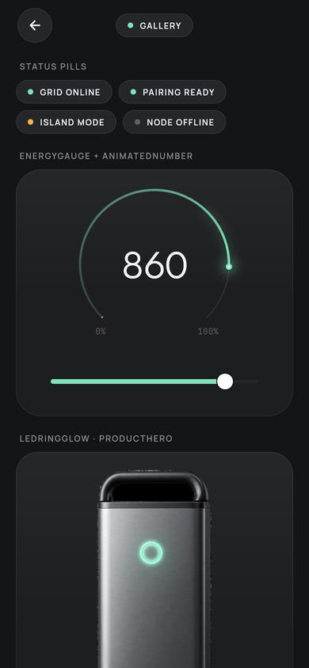 |

Screens are rendered headlessly on CI (`test_screens/`) from the real widgets and the simulator at 12:30 on a clear day.

## Quality

- `flutter analyze`: zero issues (infos are fatal in CI).
- Unit tests for every metric formula and the simulator's state machine (outage, restore, low reserve, offline, fast-forward, commissioning).
- Layout smoke tests: every route and every home tab at 360×740, 390×844 and 430×932, failing on any overflow.
- CI on every push: format, analyze, tests, screen renders and a release APK.

## Decisions

Every assumption (simulator constants, tariffs, CO₂ factor, the `kWh` unit fix, LED measurements, font strategy) is documented in [`docs/DECISIONS.md`](docs/DECISIONS.md).
